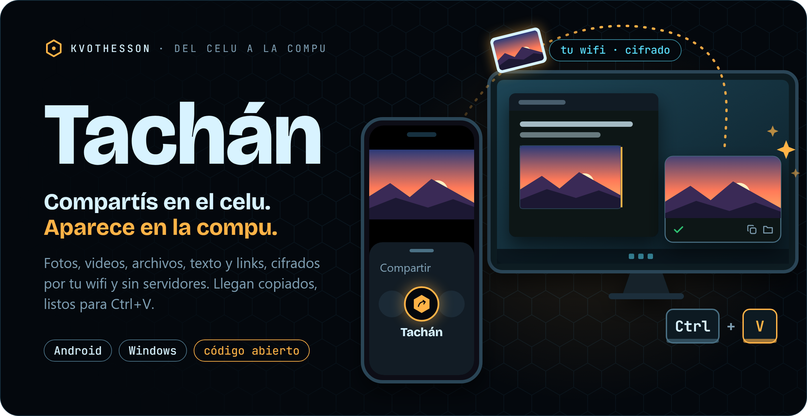
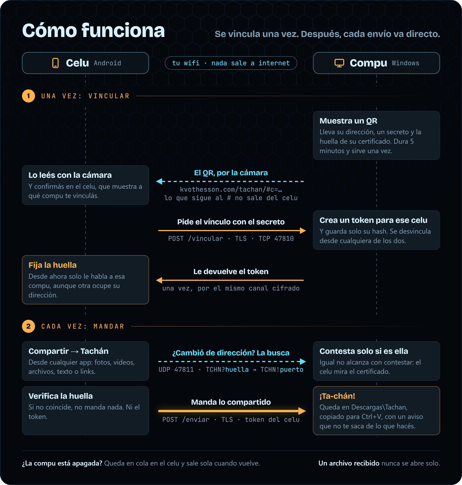

  <a href="https://kvothesson.com/tachan/"><b>Bajar Tachán</b></a> ·
  <a href="https://kvothesson.com/tachan/comprobar.html">Cómo comprobarlo</a> ·
  <a href="https://kvothesson.com/tachan/privacidad.html">Privacidad</a> ·
  <a href="https://kvothesson.com/tachan/en.html">English</a>

Compartís algo en el celu y aparece en la compu: fotos, videos, archivos, texto y links. Va por el wifi de tu casa, cifrado, sin cuenta y sin pasar por ningún servidor.

Llega **copiado**, listo para Ctrl+V (Cmd+V en Mac) donde estabas, con un aviso chiquito que no te saca de lo que hacés. Del aviso se puede arrastrar, y se va solo en 6 segundos. También queda guardado en `Descargas\Tachan` (en Mac, `~/Downloads/Tachan`).

Este repo tiene el código completo de las dos apps y de la web, abierto para que cualquiera pueda comprobar qué hace. Sin servidores, sin rastreo y sin dependencias: menos de 100 KB en Windows y en Android, y unos 300 KB la app universal de Mac.

## Cómo funciona

Todo pasa entre tus dos equipos. La compu escucha en el puerto TCP 47810 (HTTPS propio) y contesta búsquedas en el UDP 47811. Solo sale a internet si tocás **Buscar actualización**.

## Qué hay acá

| Carpeta | Qué es |
|---|---|
| [`pc/`](pc) | El programa de Windows: un `.exe` de 98 KB en C# sobre .NET 4.8, que ya viene con Windows. Se instala solo en `%LOCALAPPDATA%\Programs\Tachan`, y abrir una versión distinta lo actualiza. |
| [`mac/`](mac) | La app de Mac, para macOS 15 o más nuevo: Swift y AppKit, sin Xcode ni paquetes, universal (Apple Silicon e Intel). Habla el mismo protocolo, así que el APK no cambia. Se instala sola en `~/Applications` y vive en la barra de menú. |
| [`android/`](android) | La app: 73 KB, sin Gradle ni librerías. El protocolo está en `Transporte.java`, en Java puro, para poder probarlo contra el `.exe`. `QrLector.java` y `Lector.java` son un lector de QR propio. |
| [`web/`](web) | La página, la privacidad y cómo comprobarlo. GitHub la publica sola en [kvothesson.com/tachan](https://kvothesson.com/tachan/) cuando cambia algo de esta carpeta ([`web.yml`](.github/workflows/web.yml)). Las descargas salen de las [releases](https://github.com/kvothesson/tachan/releases) de este repo. |
| [`tienda/`](tienda) | La ficha de Google Play en 6 idiomas. |
| [`pruebas/`](pruebas) | Pruebas de punta a punta, de memoria y de velocidad (ver abajo). |
| [`diseno/`](diseno) | El sonido de llegada, bocetos, el video de la web y las imágenes de este README (`diseno/readme/`, se sacan con `python diseno/readme/sacar.py`). |

Los colores (`pc/MarcaColores.cs`, `pc/marca.json`, `web/marca.css` y `android/res/values*/marca.xml`) salen de un sistema de marca que vive fuera de este repo, y no se editan a mano.

## Compilar

No hay Gradle ni paquetes que bajar.

- **Compu:** hace falta Python 3 y el compilador de C# de Visual Studio 2022 Build Tools. `python pc/compilar.py` deja el exe en `pc/compilado/`.
- **Mac:** en una Mac, con las Command Line Tools de Xcode (`xcode-select --install`) y Python 3. `python3 mac/compilar.py` deja `mac/compilado/Tachan.app`, firmada ad hoc, y el zip en `web/`.
- **Celu:** hace falta el SDK de Android (plataforma y build-tools 36) y un JDK 17. Las rutas están arriba de `android/compilar.py`: cambialas por las tuyas. `python android/compilar.py` deja un APK firmado con una llave de desarrollo que se crea sola; con `--tienda` también sale el AAB para Google Play.

Un APK compilado por vos no se instala encima del oficial, porque la firma es otra: hay que desinstalar y volver a vincular. Las llaves de publicación no están en el repo.

<b>Pruebas</b>

Usan datos aislados con `TACHAN_DATOS`, así no tocan tu instalación.

| Prueba | Qué mira |
|---|---|
| `prueba_e2e.py` | El protocolo y la seguridad, de punta a punta (en Windows y en Mac) |
| `prueba_pc.py` | Aviso, portapapeles, arrastre y pegado (mueve el mouse de verdad) |
| `prueba_copia.py` | El portapapeles, sin mover el mouse |
| `prueba_demorado.py` | Lo que sale de la cola no pisa el portapapeles |
| `prueba_arriba.py` | El aviso aparece sobre una ventana a pantalla completa |
| `prueba_aviso_imagen.py` | Imágenes altas, anchas y transparentes, enteras |
| `prueba_memoria.py` | Memoria y recursos con muchas fotos |
| `prueba_puerto_ocupado.py` | Con el puerto ocupado, espera o avisa en vez de caerse |
| `prueba_buscar_version.py` | Buscar actualización contra una web local |
| `prueba_firma.py` | Solo baja una actualización firmada con nuestra llave |
| `prueba_actualizar.py` | Reemplaza la instalación real sin perder vínculos |
| `prueba_actualizar_mac.py` | En Mac: solo instala una actualización firmada, y reemplaza la instalada sin tocar los datos |
| `prueba_lector.py` | El QR real, deformado como lo ve una cámara |
| `medir_envio.py` | Un envío real desde el selector de fotos, con el celu bloqueado |
| `medir_velocidad.py` | El protocolo solo |
| `medir_celu.py` | Arranque de la app y del lector |

## Seguridad

- Se vincula con un QR que dura 5 minutos, sirve una sola vez y se invalida tras 5 intentos fallidos. Siempre pide confirmar en el celu.
- Todo va cifrado con TLS. El celu fija la huella del certificado de la compu: si otra máquina ocupa su dirección, no le manda nada, ni el token.
- Cada celu tiene su token, y en la compu solo se guarda el hash. Se puede desvincular desde cualquiera de los dos.
- El firewall admite solo equipos de la misma red.
- Un archivo recibido nunca se abre solo. Solo los medios se abren con doble clic, y Windows trata lo recibido como bajado de internet. Un link solo se abre si tocás la flecha.

[`REVISION_SEGURIDAD.md`](REVISION_SEGURIDAD.md) tiene la revisión hecha sobre la 1.2, lo que se arregló en la 1.3 y lo que queda. La hizo una IA, así que todavía falta una mirada de afuera: si sabés del tema, sos bienvenido.

**Si encontrás una falla de seguridad,** avisá en privado desde [este formulario](https://github.com/kvothesson/tachan/security/advisories/new) y no en un issue público.

## Aportar

Los errores y las ideas van en los [issues](https://github.com/kvothesson/tachan/issues), y los cambios por pull request. Tachán hace una sola cosa y pesa menos de 100 KB por lado: los cambios que suman dependencias, cuentas, servidores o conexiones a internet no entran.

Está hecho con ayuda de IA (Claude). [`AGENTS.md`](AGENTS.md) es la guía que usa para trabajar acá, con decisiones, pruebas y cómo publicar, y sirve igual para una persona.

## Licencia

GPLv3: ver [`LICENSE`](LICENSE). Podés usarlo, estudiarlo y cambiarlo. Si repartís una versión cambiada, tiene que seguir abierta con la misma licencia, y ponele otro nombre e ícono, así no se confunde con la original.

En pantalla es Tachán; en tiendas, rutas y código, Tachan. El paquete `com.kvothesson.tachan` no se puede cambiar después de publicar en Google Play.

Hecho por <a href="https://kvothesson.com/">Kvothesson</a>

